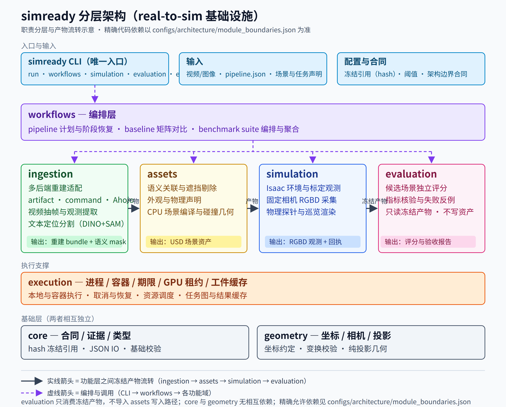

# Video to SimReady

面向 real-to-sim 的基础设施：核心 video → reconstruction → USD 流水线、候选场景独立验收，以及隔离的 Isaac Sim 容器部署。

[](https://github.com/miracle-techlink/video-to-simready/actions/workflows/test.yml) · [开发者指南：架构、baseline 与 benchmark 接入](docs/README.md)

| 分支 | 内容 |
|---|---|
| `main` | 核心流水线、baseline 接入、资产与物性、独立验收、执行设施、Isaac Sim 部署及必要测试 |
| [`aloho-hackson`](https://github.com/miracle-techlink/video-to-simready/tree/aloho-hackson) | 分离前的完整版本：Aholo 黑客松、专用机器人任务、Agent 修复／经验、研究代码、视频物料与历史报告（历史存档，不再演进） |
| `feat/digua-hackathon-drone-substation` | 无人机专用场景／控制／任务；核心 pipeline 从 main 同步，通用改动先回 main |

main 保留 `artifact`、`command`、`aholo` 重建后端。Aholo 云端模型由服务方提供，本仓库实现客户端与下游处理；其他算法通过冻结输入、环境身份和统一 bundle 接入。

## 功能模块

| 模块 | 主要功能 | 典型输入 → 输出 |
|---|---|---|
| [`workflows`](src/simready/workflows) | pipeline 计划与阶段恢复、baseline 矩阵对比、benchmark suite 编排与聚合 | pipeline.json + 任务声明 → 执行计划与汇总报告 |
| [`ingestion`](src/simready/ingestion) | 视频抽帧与观测提取；`artifact` / `command` / `aholo` 多后端重建适配；文本定位分割（DINO+SAM）与真实图像 2D 区域 CLIP 编码 | 视频/图像 → 重建 bundle + 来源绑定语义 mask / 2D 区域特征 |
| [`assets`](src/simready/assets) | 语义关联与遮挡剔除、外观与物理声明、CPU 场景编译与碰撞几何 | 语义 mask + 重建几何 → USD 场景资产 |
| [`simulation`](src/simready/simulation) | Isaac Sim 环境与标定观测、固定相机 RGBD 采集与回执、物理探针与巡览渲染 | USD 场景 + 观测计划 → RGBD 观测 + 运行回执 |
| [`evaluation`](src/simready/evaluation) | 候选场景独立评分、真实数据分割评测、指标/阈值核验与失败反例、质量报告（只读冻结产物） | 冻结观测/候选产物 → 评分与验收报告 |
| [`execution`](src/simready/execution) | 本地与容器执行、取消与恢复、GPU UUID 租约、任务图与工件缓存 | 执行请求 → 进程结果与回执 |
| [`core`](src/simready/core) | hash 冻结引用证据、JSON IO、基础校验与边界类型 | 文件/JSON → 证据引用与校验结果 |
| [`geometry`](src/simready/geometry) | 坐标约定、变换校验、纯投影几何（深度反投影/多边形） | 深度/相机/位姿 → 坐标与投影结果 |

## 分层架构



图为职责分层与产物流转示意；精确代码依赖以[架构合同](configs/architecture/module_boundaries.json)为准。[可编辑 SVG 源文件](docs/images/architecture.svg)。

## Latest News

- **2026-11-15 — Benchmark GPU 流水线修复（[#25](https://github.com/miracle-techlink/video-to-simready/pull/25)）**：修复 worker 启动、输入打包、回执绑定与候选评分编排，并合入 main。PR head `0c04648` 的 native Isaac Sim 6.2 production suite 在 L40 上 2/2 成员执行完成，自动候选双视角评分通过；Docker/Isaac 6.1 和 Kit/RTX 真冷缓存仍未验收，评分仅为估计参考图上的 renderer reproduction。
- **2026-11-15 — 工厂无人机仿真飞行演示**：在 NVIDIA Isaac Sim Factory USD 场景中使用 Iris 四旋翼模型完成 57.27 秒预设航点跟踪，并归档追随/FPV 双视角录像与轨迹。运行记录位于服务器 `/root/gpufree-data/liuyue/drone-tests/factory-full-record-20261115-191500/`；这是脚本航点演示，不代表自主导航或全场景无碰撞验收。
- **2026-11-15 — 真实图像与分割评测**：加入真实图像 2D 区域 CLIP 编码及缓存证据校验，并提供 COCO 小样本分割评测工具与预测证据校验；工具上线不等于分割质量达标（[#24](https://github.com/miracle-techlink/video-to-simready/pull/24)、[#26](https://github.com/miracle-techlink/video-to-simready/pull/26)）。
- **2026-11-15 — Isaac 部署指南**：补充实测导向的本地安装与运行指引（[#27](https://github.com/miracle-techlink/video-to-simready/pull/27)）。
- **2026-11-15 — Benchmark 与 CI**：加入统一 benchmark 输入合同、候选场景独立评分与批量对比编排，完善 CPU/打包测试与失败报告（[#21](https://github.com/miracle-techlink/video-to-simready/pull/21)、[#22](https://github.com/miracle-techlink/video-to-simready/pull/22)）。
- **2026-11-14 — 核心流水线整理**：支持阶段恢复与多重建后端接入，整理通用模块、示例与开发文档（[#14](https://github.com/miracle-techlink/video-to-simready/pull/14)–[#19](https://github.com/miracle-techlink/video-to-simready/pull/19)）。
- **2026-11-13 — 视频到场景**：新增可恢复的视频到 USD 流程，以及多类别语义资产与逐物体物性写入（[#7](https://github.com/miracle-techlink/video-to-simready/pull/7)、[#13](https://github.com/miracle-techlink/video-to-simready/pull/13)）。

<details><summary>Earlier news (2026)</summary>

- 2026-11-12 — 执行与工具：资源感知调度、结果缓存和统一 CLI（[#1](https://github.com/miracle-techlink/video-to-simready/pull/1)–[#3](https://github.com/miracle-techlink/video-to-simready/pull/3)）。
- 2026-11-10 — 项目开源：发布初始代码与示例。

</details>

## To-do

- [x] 在 native Isaac Sim 6.2/L40 上运行 production benchmark suite：多视角采集 → 候选生成 → 独立评分（PR #25 head `0c04648`，2/2 成员执行完成；仅验证估计参考图上的 renderer reproduction）。
- [ ] Docker/Isaac 6.1 全链与 Kit/RTX 真冷缓存复验；需要可用的 Docker-capable runner 和隔离 Kit portable cache 的验收环境。
- [ ] 三维点特征对齐。
- [ ] 更大真实数据集分割评测与质量改进。
- [ ] 带尺度/位姿参考的数据集上的重建评测。
- [x] 工业工厂场景与 Iris 四旋翼模型的预设航点跟踪演示；完整范围与未验收项见服务器运行记录。自主导航仍待完成。
- [ ] 自主定位/避障/导航训练。
- [ ] 受控 GPU CI 与部署回滚。

> 通用能力经 PR 合入 main；活动分支保留专用场景与任务配置。详细进度与验收记录见 [DEVELOPMENT_PROGRESS.md](docs/DEVELOPMENT_PROGRESS.md) 与 [2026-11-14 验收摘要](docs/progress/2026-11-14-acceptance.json)。

## CPU 快速开始

需要 Python 3.10+ 与系统 FFmpeg；无需 GPU、账号或私有数据。

```bash
git clone https://github.com/miracle-techlink/video-to-simready.git
cd video-to-simready
python -m venv .venv
source .venv/bin/activate
python -m pip install -e '.[physical-assets]'
python examples/pipeline/create_fixture.py --out /tmp/simready-inputs
simready run --pipeline /tmp/simready-inputs/pipeline.json --out /tmp/simready-run
simready run --pipeline /tmp/simready-inputs/pipeline.json --out /tmp/simready-run --resume
```

此示例使用合成输入，验证 USD 导出、独立参数读回和恢复。真实视频与重建复用见[视频示例](examples/pipeline/README.md#真实视频)，多算法对比见[baseline 矩阵](examples/reconstruction/README.md#比较后端)。

## Isaac Sim worker

```bash
docker build --build-arg ISAAC_IMAGE=nvcr.io/nvidia/isaac-sim:6.1.0 \
  -t simready-isaac-core:6.1.0 -f deploy/isaac/Dockerfile deploy/isaac
python scripts/launch_isaac.py --assets examples/pipeline --out runs/isaac-check \
  --doctor --launch-smoke --accept-eula
```

执行前准备 Docker、NVIDIA Container Toolkit、适用的 NVIDIA 许可与 GPU 环境。源码与输入只读挂载；镜像不包含场景、模型权重或密钥。环境身份和运行约束见[容器与运行](docs/README.md#容器与运行)。

## 开发边界

模块分工、代码构造、baseline／benchmark 接入及测试流程统一见[开发者指南](docs/README.md)，包含可运行的后端接入与独立评分示例。公开示例验证接口与恢复，完整几何、真实物性与模型精度需各自评测。唯一命令入口为 `simready`；专用场景、Agent 及旧 CLI 别名使用完整分支。
